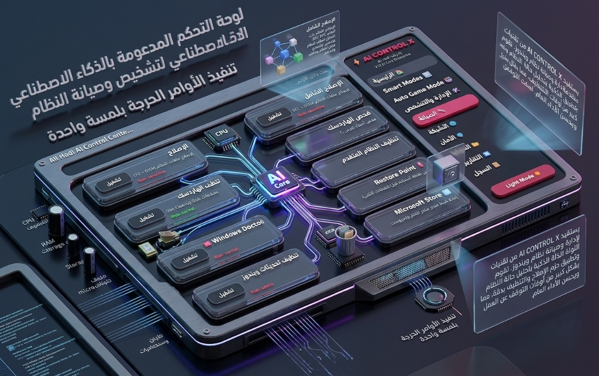

# Ali Hadi AI Control Center X (V13 AI Core Enterprise)
**المنصة الذكية المتكاملة لإدارة وتصحيح أعطال ويندوز بالذكاء الاصطناعي | تطوير: Ali Hadi**

---

## 📸 النظرة العامة على النظام / Visual Overview

---

## 📖 نبذة عن المنصة / Overview

**Ali Hadi AI Control Center X (V13 AI Core Enterprise)** هي منظومة ذكية متقدمة تم تطويرها بواسطة **علي هادي (Ali Hadi)**، تستفيد من تقنيات التحليل الذكي للبيئة البرمجية لتشخيص وإدارة وصيانة نظام تشغيل Windows، تحليل أوقات التوقف والبطء، وتطبيق حزم الإصلاح والتنظيف والتسريع بدقة متناهية وبلمسة واحدة.

تتميز المنصة بتصميم زجاجي ثلاثي الأبعاد عصري يدعم كلا النمطين **Dark Mode** و **Light Mode**، مع نظام مؤشرات مرئي لإدارة مستويات الأمان والمخاطر.

**Ali Hadi AI Control Center X (V13 AI Core Enterprise)** is an intelligent diagnostic, maintenance, and enterprise performance management platform engineered for Windows by **Ali Hadi**. Built with predictive AI heuristics, it provides automated system repair, risk-classified operation flows, deep component cleaning, and low-latency gaming profiles.

---

## ✨ المميزات الاستثنائية / Key Features

- 🎮 **Smart Modes & Auto Game Mode**: وضع الألعاب والتكيف الذكي لمنح الألعاب ونواة المعالج أعلى أولوية تشغيل مع تقليل زمن الاستجابة (Latency) إلى أدنى حد ممكن.
- 🩺 **الإصلاح الشامل والدقيق**: تنفيذ أوامر فحص وإصلاح ملفات النظام الحرجة (`SFC` و `DISM`) لإصلاح واستعادة أي ملفات نظام تالفة تلقائياً بضغطة زر.
- 💾 **صيانة الأقراص والتنظيف المتقدم**: فحص قرص النظام (`CHKDSK`) لمعالجة أخطاء القرص C، وتنظيف عميق لمخلفات وحزم الـ Component Store المؤقتة لتوفير مساحة حرة هائلة.
- 👨‍⚕️ **طبيب ويندوز (Windows Doctor)**: فحص وتشخيص استباقي للخدمات الحيوية مثل **Windows Update**، و **Windows Defender**، وخدمة النقل الذكي في الخلفية **BITS**.
- 🛡️ **نظام إدارة المخاطر (Visual Risk Levels)**: تصنيف لوني وأمني واضح لكل أمر وإجراء:
  - 🟢 **Normal**: أوامر صيانة روتينية آمنة تماماً.
  - 🟡 **Admin**: تتطلب صلاحيات وصول إدارية مرتفعة.
  - 🔴 **Sensitive**: عمليات نظام حساسة تتطلب تأكيداً لضمان عدم تنفيذ أي إجراء حرج دون علمك.
- 🛒 **إدارة المتجر ونقاط الاستعادة**:
  - **Microsoft Store Reset**: زر فوري لإصلاح وإعادة ضبط متجر مايكروسوفت عند حدوث أخطاء التحميل.
  - **Restore Point**: إنشاء نقطة استعادة تلقائية للنظام قبل تطبيق أي تعديلات لضمان أقصى درجات الأمان.
- 🎨 **تصميم زجاجي عصري ودعم المظاهر**: دعم التبديل السلس بين النمط المضيء (**Light Mode**) والنمط الليلي (**Dark Mode**).

---

## 💻 متطلبات وبيئة التشغيل / System Requirements

- **نظام التشغيل / OS**: Windows 10 أو Windows 11 (64-bit).
- **المعالجات / CPU**: دعم شامل لجميع أجيال معالجات Intel Core و AMD Ryzen.
- **الصلاحيات**: **يجب تشغيل الأداة بصلاحية مسؤول النظام (`Run as Administrator`)** للوصول لخدمات الـ Kernel وأوامر SFC و DISM وصيانة الأقراص.

---

## 🚀 طريقة التشغيل والاستخدام / How to Run

1. قم بتحميل الملف التنفيذي `Ali Hadi AI Control Center X V13.exe` من قسم [Releases](../../releases) أو من هذا المستودع.
2. انقر بزر الفأرة الأيمن على الملف ثم اختر **تشغيل كمسؤول (Run as Administrator)**.
3. استعرض الواجهة الزجاجية التفاعلية واختر الأوامر والوظائف المرغوبة بحسب مستوى الأمان المطلوب.
4. يوصى دائماً بالضغط على **Restore Point** قبل تنفيذ الأوامر المصنفة كـ Sensitive.

---

## 👨‍💻 التطوير والإشراف / Developer & Credits

- **هندسة وتطوير / Engineered & Developed by**: **علي هادي (Ali Hadi)**
- **الإصدار / Version**: `V13 AI Core Enterprise`
- **البريد الإلكتروني / Email**: `aloll@live.com`
- **حساب GitHub**: [@binhadi](https://github.com/binhadi)

---

## 📄 الترخيص / License

هذا البرنامج متاح للاستخدام بموجب رخصة [MIT License](LICENSE).
